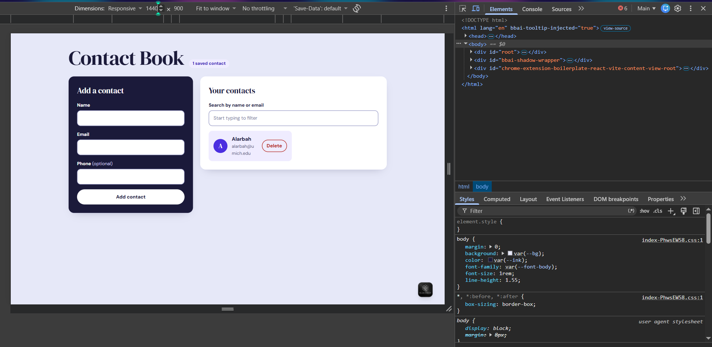
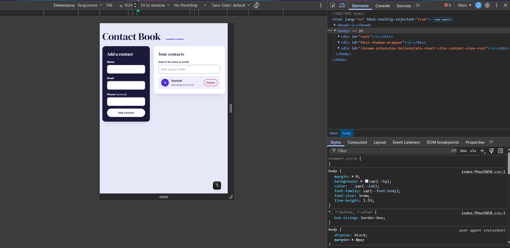

# Contact Book

A single-page React app (Vite) for adding, listing, searching, and deleting contacts. Data lives in memory for the session only.

**Live site:** https://YOUR-USERNAME.github.io/YOUR-REPO-NAME/

## Features
- Add a contact (Name and Email required, Phone optional) with controlled inputs and inline validation
- Contacts listed with stable `id` keys
- Case-insensitive search by name or email
- Delete a contact
- Empty state ("No contacts yet. Add one above!") and no-match state ("No matches found for ‘…’")
- Responsive layout with visible focus states

## Components
`App` (owns state) → `ContactForm`, `SearchBar`, `ContactList` → `ContactItem`

## Run locally
```bash
npm install
npm run dev
```

## Screenshots

### Desktop


### Tablet


### Mobile

